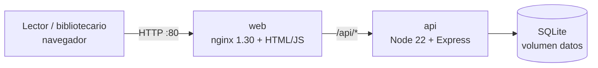

# BiblioHuila · préstamos de biblioteca

Demo del Corte 3 de **Arquitectura de Software (CORHUILA)**: cómo se lleva un proyecto que
«funciona en mi máquina» a uno listo para **CI/CD**, aplicando un cambio de clean code por
rama y por Pull Request.

- Estado inicial: tag [`antes`](../../tree/antes) (todo en un `index.js`, claves en el código, sin pruebas).
- Los 14 cambios: [Pull Requests cerrados](../../pulls?q=is%3Apr+is%3Aclosed), uno por rama `cambio/NN-…`.
- Arquitectura (C4, despliegue y pipeline): [`docs/arquitectura/`](docs/arquitectura/README.md).

## Correrlo

| Cómo | Comandos | Dónde |
|---|---|---|
| Docker (recomendado) | `cp .env.example .env` → `docker compose up --build -d --wait` | http://localhost:8080 |
| Sin Docker | `cp .env.example .env` → `cd api && npm ci && npm start` | http://localhost:3000 |
| Pruebas | `cd api && npm test` | 27 pruebas, sin intervención |

`docker compose down` apaga; `docker compose down -v` además borra los préstamos.

## API

| Método y ruta | Qué hace | Respuestas |
|---|---|---|
| `GET /api/health` | estado, versión desplegada y entorno | 200 · 503 |
| `GET /api/libros?q=` | catálogo (búsqueda por título) | 200 · 400 |
| `POST /api/libros` | crea un libro (cabecera `x-admin-key`) | 201 · 400 · 401 |
| `GET /api/prestamos` | todos los préstamos | 200 |
| `GET /api/prestamos/vencidos` | atrasados, con su multa | 200 |
| `POST /api/prestamos` | `{ lector, libroId }` | 201 · 400 · 404 · 409 |
| `PUT /api/prestamos/:id/devolver` | devuelve y calcula la multa | 200 · 400 · 404 · 409 |

Reglas (en `api/src/servicios/reglas.js`): máximo 3 préstamos por lector, 15 días de préstamo,
multa de $1.500 por día de retraso.

## Variables de entorno

| Variable | Para qué | Por defecto |
|---|---|---|
| `ADMIN_KEY` | clave del bibliotecario (**obligatoria**) | — |
| `PORT` | puerto de la API | 3000 |
| `RUTA_DB` | archivo SQLite | `api/datos/biblio.db` (en Docker `/data/biblio.db`) |
| `APP_VERSION` | versión que muestra `/api/health` (la pone el pipeline) | `dev` |
| `APP_ENV` | nombre del entorno | `local` |
| `PUERTO_WEB` | puerto del front en compose | 8080 |

## Pipeline

`.github/workflows/ci-cd.yml`: pruebas → imágenes + Trivy → GHCR (solo `main`) → despliegue en
EC2 con `compose.prod.yml` → verificación de `/api/health`. El despliegue solo corre si la variable
del repositorio `DESPLEGAR_EC2` vale `si` (ver el encabezado del workflow para los secretos).
