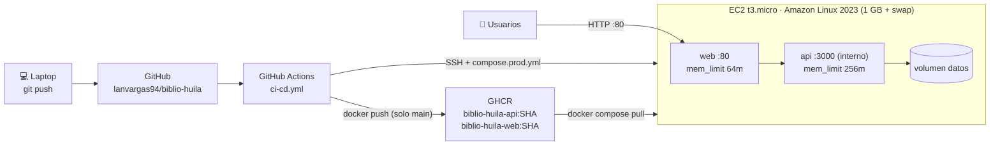

# Despliegue (Corte 3)

Security Group: entrada solo 80 (y 22 restringido a la IP del pipeline o de quien administra).
Costo de referencia: t3.micro ≈ US$0,0104/h; apagarla y borrarla al terminar la práctica.
