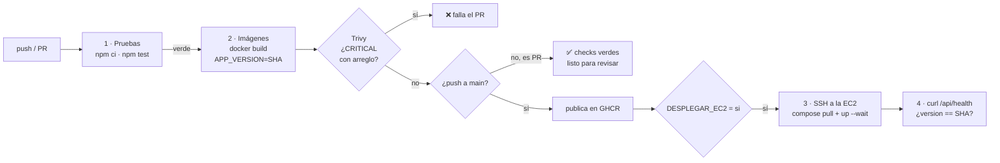

# Pipeline CI/CD

En este repositorio el paso de seguridad **sí** detuvo un PR ([#13](../../pull/13)): la imagen
`nginx:1.27-alpine` traía **3 vulnerabilidades CRÍTICAS** con arreglo: `brotli-libs`
(CVE-2026-111497) y `libcrypto3`/`libssl3` de OpenSSL (CVE-2026-31789). Subir de versión no
bastaba (todas las etiquetas de nginx traían `brotli-libs` vulnerable), así que en la misma rama
se pasó a `nginx:1.30-alpine` con `RUN apk upgrade --no-cache` (parches del sistema operativo al
construir) y el pipeline quedó en verde.
